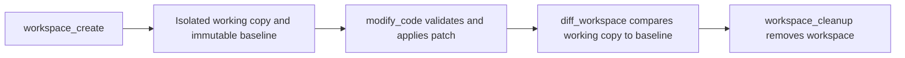

# Component Design

## Service Components

This document describes the major service components, their responsibilities, interfaces, and dependencies.

### 1. Azure OpenAI Service

**File:** `src/backend/Copilot.Api/Services/AzureOpenAIService.cs`

**Interface:** `src/backend/Copilot.Api/Services/IAzureOpenAIService.cs`

**Responsibility:** Abstraction for Azure OpenAI API access, including chat completion and embeddings.

**Public Interface:**
```csharp
public interface IAzureOpenAIService
{
    Task<string> ChatAsync(string message, CancellationToken cancellationToken = default);
    IAsyncEnumerable<string> ChatStreamAsync(string message, CancellationToken cancellationToken = default);
    Task<float[]> GetEmbeddingAsync(string text, CancellationToken cancellationToken = default);
}
```

**Dependencies:**
- Azure OpenAI SDK
- Configuration: `AzureOpenAI:Endpoint`, `AzureOpenAI:DeploymentName`, `AzureOpenAI:ApiKey`

**Lifetime:** Singleton (stateless)

**Error Handling:**
- Rate limit exceptions (429): Caller should implement retry logic
- Authentication errors (401): Logged with redacted key
- Timeout: Propagated as `OperationCanceledException`

### 2. Code Copilot Service

**File:** `src/backend/Copilot.Api/Services/Copilot/CodeCopilotService.cs`

**Interface:** `src/backend/Copilot.Api/Services/Copilot/ICodeCopilotService.cs`

**Responsibility:** Main orchestrator for copilot queries; coordinates retrieval, context building, and answer generation.

**Public Interface:**
```csharp
public interface ICodeCopilotService
{
    Task<CopilotResponse> AskAsync(
        CopilotRequest request,
        CancellationToken cancellationToken = default);
}
```

**Flow:**
1. Validates request parameters (query, repository, branch, top)
2. Checks if tool-calling service is available
3. If tool-calling available:
   - Uses `IToolCallingCodeAnswerGenerationService`
   - Retrieves tools from `ICopilotToolRegistry`
   - Generates answer with tool support
4. If tool-calling unavailable:
   - Uses `ICodeAnswerGenerationService` (standard RAG)
   - Retrieves code context
   - Generates answer
5. Returns `CopilotResponse` with content and sources

**Dependencies:**
- `ICodeRetrievalService`
- `ICodeContextBuilder`
- `ICodeAnswerGenerationService`
- `IToolCallingCodeAnswerGenerationService` (optional)
- `ICopilotToolRegistry` (optional)

**Lifetime:** Scoped

**Tests:** `tests/Copilot.Api.Tests/Copilot/CodeCopilotServiceTests.cs`

### 3. Code Retrieval Service

**File:** `src/backend/Copilot.Api/Services/Retrieval/CodeRetrievalService.cs`

**Interface:** `src/backend/Copilot.Api/Services/Retrieval/ICodeRetrievalService.cs`

**Responsibility:** Retrieves relevant code context for queries.

**Flow:**
1. Receives query, repository, branch, and top-K count
2. Calls `IQueryEmbeddingService` to embed query
3. Calls `IHybridSearchService` to search code chunks
4. Calls `IRetrievalResultProcessor` to post-process results
5. Formats results with metadata (file, line numbers)

**Dependencies:**
- `IQueryEmbeddingService`
- `IHybridSearchService`
- `IRetrievalResultProcessor`

**Lifetime:** Scoped

**Tests:** `tests/Copilot.Api.Tests/Retrieval/CodeRetrievalServiceTests.cs`

### 4. Hybrid Search Service

**File:** `src/backend/Copilot.Api/Services/Search/HybridSearchService.cs`

**Interface:** `src/backend/Copilot.Api/Services/Search/IHybridSearchService.cs`

**Responsibility:** Combined vector + keyword search for code chunks.

**Features:**
- Vector search via `IVectorSearchService`
- Keyword search via Azure AI Search API
- Result ranking/merging
- Score normalization

**Inputs:**
- Query embedding vector (float array)
- Query text (for keyword search)
- Top-K count
- Repository and branch filters

**Outputs:**
- Ranked list of `HybridSearchResult` with scores

**Dependencies:**
- `IVectorSearchService`
- Azure AI Search SDK
- Configuration: Azure Search endpoint and API key

**Lifetime:** Singleton

**Tests:** `tests/Copilot.Api.Tests/Search/HybridSearchServiceTests.cs`

### 5. Repository Ingestion Service

**File:** `src/backend/Copilot.Api/Services/Repository/RepositoryIngestionService.cs`

**Interface:** `src/backend/Copilot.Api/Services/Repository/IRepositoryIngestionService.cs`

**Responsibility:** Pipeline for processing repository files into indexed code chunks.

**Flow:**
1. Receives repository owner/name and branch
2. Calls `IRepositoryProvider` (GitHub) to fetch files
3. For each file:
   - Calls `ISourceFileClassifier` to determine file type
   - Calls `ISourceFileMetadataService` to extract metadata
   - Calls `ICodeChunkingService` to split into chunks
   - Calls `IEmbeddingService` to generate embeddings for chunks
4. Calls `ISearchDocumentIndexingService` to index chunks
5. Returns summary of ingestion (files processed, chunks created, errors)

**Dependencies:**
- `IRepositoryProvider`
- `ISourceFileClassifier`
- `ISourceFileMetadataService`
- `ICodeChunkingService`
- `IEmbeddingService`
- `ISearchDocumentIndexingService`

**Lifetime:** Scoped

**Error Handling:**
- File processing errors: Logged, continue with next file
- Embedding generation errors: Logged, skip chunk
- Indexing errors: Logged, return error count in response

**Tests:** `tests/Copilot.Api.Tests/Repository/RepositoryIngestionServiceTests.cs`

### 6. Code Chunking Service

**File:** `src/backend/Copilot.Api/Services/Repository/CodeChunkingService.cs`

**Interface:** `src/backend/Copilot.Api/Services/Repository/ICodeChunkingService.cs`

**Responsibility:** Splits code files into semantic chunks for embedding and indexing.

**Algorithm:**
- Language-aware chunking (preserves code structure)
- Configurable chunk size (tokens)
- Overlap between chunks for context
- Preserves line numbers and file path

**Inputs:**
- File path
- File content (source code)
- File language

**Outputs:**
- List of `CodeChunk` with content, line numbers, and metadata

**Lifetime:** Singleton

**Tests:** `tests/Copilot.Api.Tests/CodeChunkingServiceTests.cs`

### 7. Tool Registry and Tools

**File:** `src/backend/Copilot.Api/Services/Tools/`

**Responsibility:** Extensible framework for copilot tools.

**ICopilotTool Interface:**
```csharp
public interface ICopilotTool
{
    string Name { get; }
    string Description { get; }
    Task<ToolResult> ExecuteAsync(ToolInput input, CancellationToken cancellationToken);
}
```

**Registered Tools:**

1. **CodeSearchTool** (`CodeSearchTool.cs`)
   - Searches for code matching queries
   - Uses hybrid search internally
   - Returns file paths and code snippets

2. **FileInspectionTool** (`FileInspectionTool.cs`)
   - Reads and returns file contents
   - Validates file paths (security)
   - Returns file metadata and content

3. **WorkspaceCreateTool**, **ModifyCodeTool**, **DiffWorkspaceTool**, and
   **WorkspaceCleanupTool**
   - Create isolated snapshots of supported GitHub source/text files
   - Apply validated create, update, and delete operations only in a workspace
   - Return unified diffs against the immutable imported baseline
   - Remove a workspace and its baseline when requested

**CopilotToolRegistry:**
- Returns all available tools
- Tools are registered in Program.cs
- Supports dynamic tool loading (future enhancement)

**Lifetime:** Tools are Scoped; Registry is Scoped

**Tests:** `tests/Copilot.Api.Tests/Tools/CodeSearchToolTests.cs`, etc.

### 8. Workspace and Patch Services

**Files:** `src/backend/Copilot.Api/Services/Workspace/`

**Responsibilities:**
- `WorkspaceManager` imports a GitHub snapshot pinned to a commit SHA and stores workspace metadata
- An immutable baseline is kept separately from the editable working directory
- `PatchApplicationService` validates file operations and path boundaries, checks optional SHA-256 preconditions, and rolls back applied operations after a failed patch
- `DiffService` compares the working copy with the exact baseline and returns text diffs for added, modified, and deleted files
- `WorkspaceOperationLock` serializes modifications, diff reads, and cleanup for a workspace

**Safety boundaries:**
- File paths must be relative repository paths using `/` separators
- Traversal paths, metadata paths, symbolic links, and reparse points are rejected
- Snapshot and patch file-count/byte limits are configurable through `WorkspaceOptions`
- Workspaces are temporary local copies; these services do not write to the user's checkout or push to GitHub
- The workspace is not an OS sandbox, and no commands or generated code are executed

**Configuration:** `Workspace:RootDirectory`, `MaximumSnapshotFiles`,
`MaximumSnapshotBytes`, `MaximumPatchFiles`, and `MaximumPatchBytes`.

**Tests:** `tests/Copilot.Api.Tests/Workspace/WorkspaceWorkflowTests.cs`

**Workflow:**



### 9. Build and Test Execution

**Files:** `src/backend/Copilot.Api/Services/Workspace/`

**Responsibilities:**
- `BuildTestExecutionService` runs only fixed `dotnet build` and `dotnet test`
  operations against a workspace-relative solution or project
- `CommandProcessRunner` starts the executable without a shell, captures bounded
  output, and attempts process-tree termination after timeout or cancellation
- `BuildTestExecutionApproval` is request-scoped and permits one approved run
  per Copilot request; execution tools are withheld without explicit approval

**Boundaries:** Development environment only, trusted repositories only,
one process at a time, 600-second default timeout, 131,072-character output cap.
Package restore may access the network. Child processes receive no application
credentials through inherited environment variables. This does not sandbox
operating-system file access or enforce CPU, memory, or disk quotas; see
`docs/architecture/security.md`.

**Configuration:** `BuildTestExecution:Enabled`, `TimeoutSeconds`, and
`MaximumOutputCharacters`.

**Tests:** `tests/Copilot.Api.Tests/Workspace/WorkspaceWorkflowTests.cs` and
`tests/Copilot.Api.Tests/Copilot/CodeCopilotToolCallingTests.cs`

### 10. Architecture Analysis Service

**File:** `src/backend/Copilot.Api/Services/ArchitectureAnalysis/ArchitectureAnalysisService.cs`

**Interface:** `src/backend/Copilot.Api/Services/ArchitectureAnalysis/IArchitectureAnalysisService.cs`

**Responsibility:** Analyzes repository architecture using code context.

**Inputs:**
- Repository owner/name
- Branch
- Optional focus area (e.g., "authentication", "database")

**Outputs:**
- `ArchitectureAnalysisResponse` with components, risks, and recommendations

**Process:**
1. Ingests repository (if not already indexed)
2. Retrieves relevant code with architecture queries
3. Sends context to AI for analysis
4. Structures AI response into components and risks

**Lifetime:** Scoped

**Tests:** `tests/Copilot.Api.Tests/ArchitectureAnalysis/ArchitectureAnalysisServiceTests.cs`

### 11. Code Review Service

**File:** `src/backend/Copilot.Api/Services/CodeReview/CodeReviewService.cs`

**Interface:** `src/backend/Copilot.Api/Services/CodeReview/ICodeReviewService.cs`

**Responsibility:** Reviews code snippets for quality, security, and style issues.

**Inputs:**
- Code snippet
- Language
- Optional context (file path, surrounding code)

**Outputs:**
- List of findings (issues, suggestions)

**Lifetime:** Scoped

### 12. Test Generation Service

**File:** `src/backend/Copilot.Api/Services/TestGeneration/TestGenerationService.cs`

**Interface:** `src/backend/Copilot.Api/Services/TestGeneration/ITestGenerationService.cs`

**Responsibility:** Generates test cases for given code.

**Inputs:**
- Code snippet
- Language
- Optional test framework preference

**Outputs:**
- List of generated test cases

**Lifetime:** Scoped

## Repository Provider

**File:** `src/backend/Copilot.Api/Services/Repository/GitHubRepositoryProvider.cs`

**Interface:** `src/backend/Copilot.Api/Services/Repository/IRepositoryProvider.cs`

**Responsibility:** GitHub API client for repository access.

**Public Methods:**
- `GetFilesAsync()`: List files in repository
- `GetFileContentAsync()`: Fetch file contents
- `GetBranchesAsync()`: List branches
- `GetRepositoryMetadataAsync()`: Fetch repo metadata

**Authentication:**
- GitHub token via configuration
- User Agent header required by GitHub

**Rate Limiting:**
- 60 requests/hour (unauthenticated)
- 5000 requests/hour (authenticated)
- No local rate limiting implemented; caller responsible for throttling

**Lifetime:** HttpClient-scoped via factory

**Error Handling:**
- 404 (Not Found): Thrown as `ArgumentException`
- 403 (Forbidden): Likely rate limit; caller should retry with backoff
- 5xx: Transient; caller should implement retry logic

## Component Dependency Graph

```
┌─────────────────────────────────────────┐
│       CopilotEndpoints (HTTP)           │
└────────────────────┬────────────────────┘
                     │
                     ▼
        ┌────────────────────────┐
        │ CodeCopilotService     │
        │ (Orchestrator)         │
        └────┬────────┬──────┬───┘
             │        │      │
        ┌────▼───┐ ┌──▼──┐ ┌─▼───────────────────┐
        │ Code   │ │Code │ │Tool-Calling Service │
        │Retrieval│ │Answer│ (Optional)          │
        │Service  │ │Gen  │ └─┬──────────┬────────┘
        └────┬────┘ └──┬──┘   │          │
             │         │      ▼          ▼
        ┌────▼───────┐ │   ┌────────────────┐
        │Query       │ │   │Tool Registry   │
        │Embedding   │ │   │• CodeSearch    │
        │Service     │ │   │• FileInspect   │
        └────┬───────┘ │   └────────────────┘
             │         │
        ┌────▼──────────▼─────┐
        │ Hybrid Search       │
        │ Service             │
        └────┬─────┬──────────┘
             │     │
        ┌────▼──┐ ┌▼──────────────────┐
        │Vector │ │SearchDocument     │
        │Search │ │IndexingService    │
        └───────┘ └──────────────────┘
             │
        ┌────▼───────────────────────┐
        │Azure AI Search API         │
        └────────────────────────────┘
```

## Configuration and Initialization

Services are registered in `Program.cs`:

```csharp
builder.Services.AddSingleton<IAzureOpenAIService, AzureOpenAIService>();
builder.Services.AddScoped<ICodeRetrievalService, CodeRetrievalService>();
builder.Services.AddScoped<ICodeCopilotService, CodeCopilotService>();
// ... more registrations
```

Options are bound from `appsettings.json`:

```csharp
builder.Services.AddOptions<AzureSearchOptions>()
    .Bind(builder.Configuration.GetSection(AzureSearchOptions.SectionName));
```

## Related Documents

- [Architecture Overview](architecture-overview.md) - High-level system architecture
- [Data Flow](data-flow.md) - Component interaction flows
